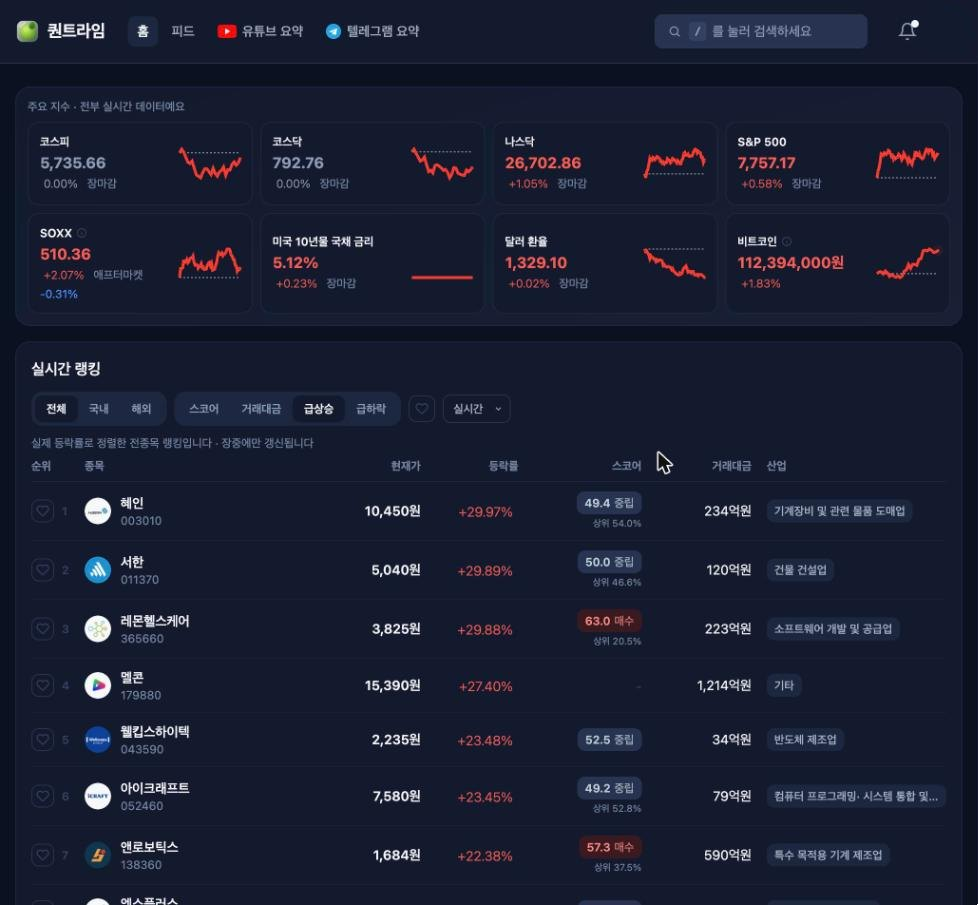
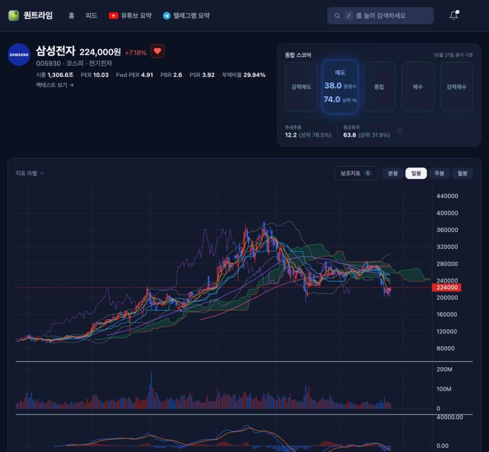
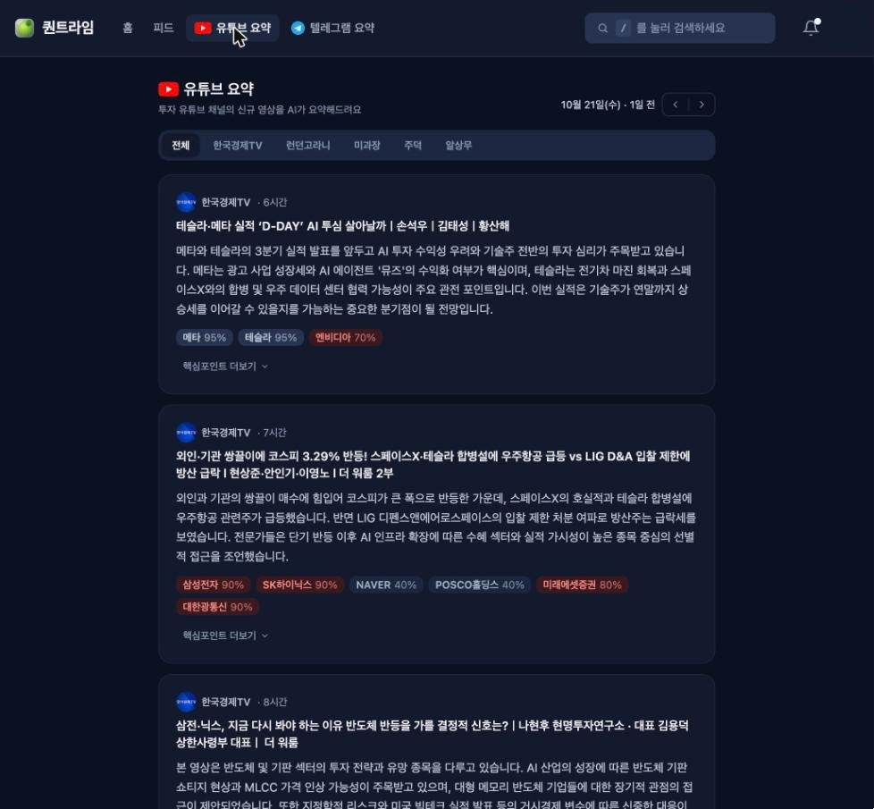
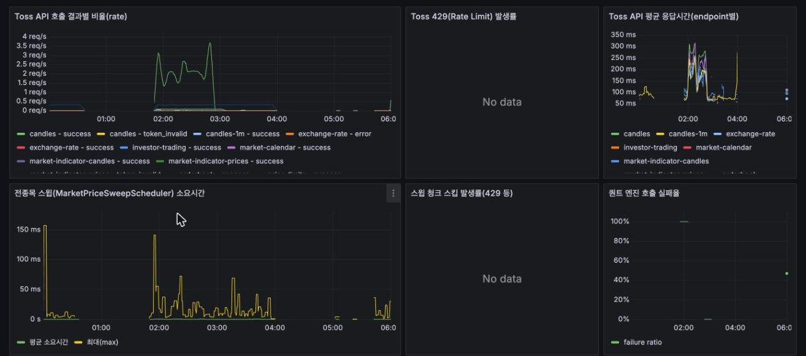
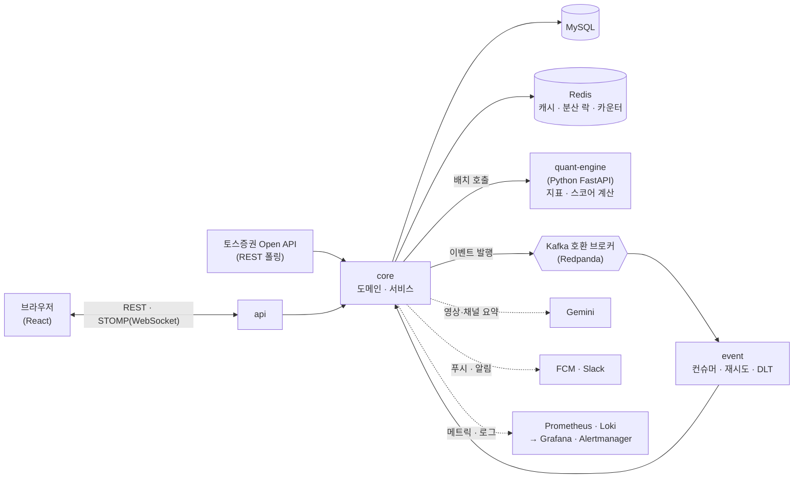

# QuantLime

[](https://github.com/ParkJuhan94/quantlime/actions/workflows/ci.yml)

국내외 주식을 기술적 지표로 점수화하고, 관심 종목을 실시간으로 모니터링하는 서비스입니다. 주문 기능 없이 **조회·분석**에 집중한 개인 프로젝트로,
기획부터 배포·운영까지 혼자 맡았습니다. 모든 개발 과정에 Claude Code를 사용했습니다. 백엔드·퀀트 엔진·인프라는 제가 설계하고 구현은 AI가 맡았으며,
프론트엔드는 예제 디자인과 디자인 규칙을 준 상태에서 AI가 구현한 결과를 검토하며 완성했습니다. 무엇을 만들지와 어떻게 검증할지는 제가 정하고 책임집니다.

- **라이브 사이트** : https://quantlime.com
- **한 문장 요약** : 토스증권 Open API 시세를 STOMP로 중계하고, 종목별 지표 점수와 투자 콘텐츠 요약을 제공하는 풀스택 서비스
- **작성 기준** : 2026-10-22, `main` 브랜치 커밋 `c304b21` 시점의 코드와 구성 (이후 변경은 반영되지 않을 수 있습니다)

> [!NOTE]
> 서버 비용 때문에 라이브 사이트는 **간헐적으로 가동** 중입니다.

<br>

## 핵심 기술 포인트

- **스코어** : 절대 점수(등급)와 횡단면 백분위(랭킹 정렬)를 분리했습니다. 단일 종합점수로 정렬하면 소형 잡주가 상위를 독식해서, 정렬용 백분위와 유동성·거래정지 필터를 따로 두었습니다.
- **장애 허용** : 외부 API(토스증권, 퀀트 엔진)에 서킷브레이커·벌크헤드·재시도를 적용하고, 캐시 갱신이 실패하면 이전 값으로 응답합니다. 서버 재부팅 뒤에는 `@reboot` 크론으로 컨테이너를 복구합니다.
- **이벤트** : 전종목 가격·스코어 처리, 구독 갱신 재시도, 결제 웹훅을 Kafka 이벤트로 분리했습니다. 재시도 + DLT, 역직렬화 실패 메시지가 컨슈머를 막지 않게 하는 옵저버, 결제 웹훅 멱등 처리를 넣었습니다.
- **품질** : 백엔드 테스트 약 1,300개, 퀀트 엔진 약 120개, 프론트 약 85개이고 Testcontainers(MySQL · Redis · Redpanda)로 통합 테스트를 돌립니다. 컴파일 경고 190건을 0건으로 정리했고 CI에서 배포용 이미지 빌드까지 확인합니다.

<br>

## 화면

| 홈 — 지수와 실시간 랭킹 | 종목 상세 — 종합 스코어와 차트 |
|:---:|:---:|
|  |  |
| **유튜브 요약 — 영상 요약과 종목 태깅** | **운영 — Grafana 대시보드** |
|  |  |

<br>

## 아키텍처



- **시세** : 토스증권은 WebSocket을 제공하지 않아, 서버가 REST로 전종목을 폴링해 STOMP로 변환해 내보냅니다.
- **스코어** : 장 마감 후 배치로 파이썬 엔진이 RSI·MACD·볼린저밴드·이동평균·거래량 등을 계산하고, 절대 점수와 횡단면 백분위를 함께 저장합니다.
- **이벤트** : 전종목 가격·스코어 처리, 구독 갱신 재시도, 결제 웹훅, 텔레그램 요약 생성을 Kafka 이벤트로 분리했습니다(`@RetryableTopic` + DLT).
- **운영** : 단일 EC2에 Docker Compose로 배포하고(GitHub Actions CD), Prometheus·Grafana·Alertmanager·Loki로 메트릭·로그·알림을 봅니다.

<br>

## 모듈 구조

```
quantlime/
├── backend/        # Spring Boot 3.3 멀티모듈 (Java 21)
├── quant-engine/   # Python FastAPI 퀀트 계산 서버 (지표 · 스코어링 · 요약)
├── frontend/       # React 19 + TypeScript (Vite)
└── monitoring/     # Prometheus · Alertmanager · Loki · Alloy · Grafana 설정
```

| 백엔드 모듈 | 역할 |
|---|---|
| `api` | REST API, WebSocket(STOMP) 엔드포인트, 인증·보안 설정 |
| `core` | 도메인, 서비스, 리포지토리(QueryDSL) |
| `event` | Kafka 이벤트 Producer · Consumer, 재시도와 DLT |
| `common` · `client-support` | 공통 예외·유틸, 외부 호출 타임아웃·재시도 공통 설정 |
| `toss` · `kis` · `naver` · `upbit` · `tradingview` | 시세·종목 데이터 연동(토스증권, 한국투자증권 종목 마스터, 네이버 금융, 업비트, 트레이딩뷰) |
| `dart` | 전자공시(DART) 연동 |
| `youtube` · `telegram` · `python` · `sync` | 투자 콘텐츠 수집(유튜브·텔레그램)과 요약·퀀트 엔진 연동 |
| `tosspayments` · `oauth` | 구독 결제(자동결제), 소셜 로그인 |
| `slack` · `firebase` | 알림 채널(Slack, FCM 푸시) |

<br>

## 기술 스택

| 영역 | 스택 |
|---|---|
| Backend | Java 21, Spring Boot 3.3, Spring Data JPA · QueryDSL, MySQL 8, Redis 7, Kafka(Redpanda), WebSocket(STOMP) |
| Quant Engine | Python 3.11+, FastAPI, pandas · numpy · pandas-ta |
| Frontend | React 19, TypeScript, Vite, Tailwind CSS v4, TradingView Lightweight Charts, React Query |
| 인프라 · 운영 | Docker Compose(단일 EC2), GitHub Actions CI/CD, Prometheus · Grafana · Alertmanager · Loki |
| 테스트 | JUnit 5, Testcontainers(MySQL · Redis · Redpanda), pytest — CI에서 백엔드 · 엔진을 검증하고 백엔드 이미지 빌드까지 확인 |

<br>

## 로컬 실행

```bash
# 인프라 + 퀀트 엔진 (MySQL 3308, Redis 6381, Redpanda, quant-engine 8000)
# quant-engine은 compose에 포함돼 함께 뜨고, 코드를 바꾸면 자동으로 다시 로드됩니다.
docker-compose up -d

# 백엔드 (backend/.env.example을 복사해 .env 작성)
cd backend && ./gradlew :api:bootRun

# 프론트엔드
cd frontend && npm run dev
```

<br>

## 라이선스

[PolyForm Noncommercial 1.0.0](LICENSE) — 채용 검토·학습 목적의 열람과 비상업적 이용은 자유지만, 상업적 이용(서비스 운영, 판매 등)은 허용하지 않습니다.
